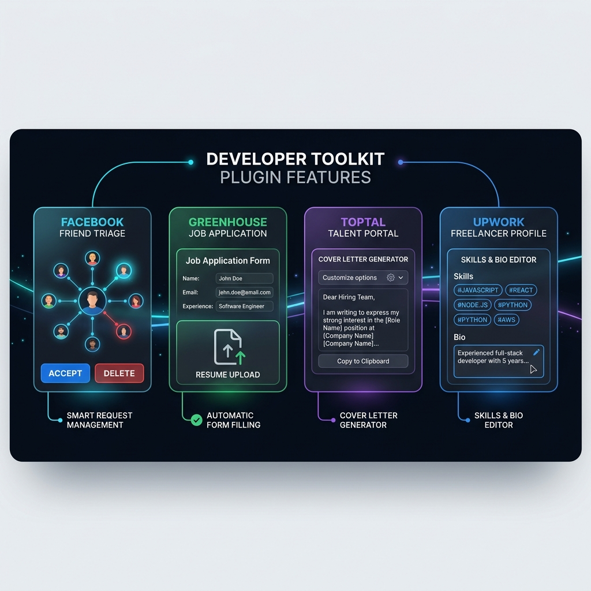

<p align="center">
  
</p>

# OpenTabs Plugins

Collection of high-impact browser automation plugins that give AI coding agents direct, authenticated access to major web platforms through active Chrome/Chromium sessions.

<p align="center">
  
</p>

---

## The Plugins

### 1. Facebook Friends Manager (`fb-friends-manager`)
**Domain:** `*://*.facebook.com/*` · **Tools:** 6

Intelligently manages pending Facebook friend requests with heuristic triage scoring, graph connection analysis, and safety-paced batch operations.

- **Request Triage Scoring (`suggest_triage`):** Evaluates pending requests against configurable mutual friend thresholds and request age. Classifies each into `ACCEPT`, `DELETE` (decline), or `REVIEW`.
- **Safety-Paced Batch Operations (`batch_triage_requests`):** Executes batch confirmations and deletions with configurable inter-request delays (default: 600ms) to respect Facebook rate limits.
- **Graph & Health Overview (`get_friends_overview`):** Summarizes mutual friend distributions (zero, low, mid, high tiers) and incoming request age breakdowns (under 1 month to 5+ years).
- **Direct Actions (`confirm_friend_request`, `delete_friend_request`):** Accepts or declines individual requests via numeric user ID or vanity username.

| Tool | Action | Description |
|---|---|---|
| `list_friend_requests` | Read | Returns pending incoming requests with mutual friend counts and timestamps |
| `suggest_triage` | Read | Generates heuristic recommendations (`ACCEPT`, `DELETE`, `REVIEW`) |
| `confirm_friend_request` | Write | Accepts an individual incoming friend request |
| `delete_friend_request` | Write | Declines or deletes an individual incoming friend request |
| `batch_triage_requests` | Write | Executes batch accept/delete actions with safety pacing |
| `get_friends_overview` | Read | Statistical breakdown of mutual friend tiers and request age |

---

### 2. Greenhouse Apply (`greenhouse`)
**Domain:** `*://*.greenhouse.io/*` · **Tools:** 3

Inspects and populates Greenhouse job application forms in real time, handling complex React custom inputs and document attachments.

- **Deep Form Inspection (`get_application_form`):** Extracts every form input, select box, checkbox group, and required validation constraint from the live page.
- **React Fiber Component Binding (`fill_application`):** Custom dropdowns in Greenhouse run on `react-select`. The plugin traverses the React fiber tree to invoke native component setters, ensuring valid form state bindings before save.
- **Document Attachment (`attach_file`):** Directly attaches resumes and cover letters via base64 buffer injection into native file inputs.
- **Human-in-the-Loop Guardrail:** The plugin intentionally never clicks "Submit Application" — final review and submission remain strictly with the user.

| Tool | Action | Description |
|---|---|---|
| `get_application_form` | Read | Maps all fields, types, required flags, options, and missing inputs |
| `fill_application` | Write | Fills text, dropdowns, and checkboxes using case-insensitive fuzzy keys |
| `attach_file` | Write | Uploads base64 resume or cover letter files into application file inputs |

---

### 3. Toptal Apply & Profile Manager (`toptal`)
**Domain:** `*://talent.toptal.com/*` · **Tools:** 9

Automates job application drafting and talent profile maintenance on the Toptal Talent Portal.

- **Job Application State Tracking (`get_apply_state`):** Reads the apply wizard step, rate, cover letter length, and terms checkbox.
- **Cover Letter Drafting (`fill_cover_letter`):** Types a 380-2000 character cover letter and ticks the terms box without submitting.
- **Profile Section Management (`get_profile_form`, `fill_profile_fields`, `save_profile`):** Reads and updates freelancer profile sections (experience, certifications, work history) across `/settings/profile/*`.
- **Custom UI Component Handlers (`pick_option`, `set_year`):** Drives Toptal's type-ahead pickers (industries, skills) and work-experience year selects.
- **Skills Management (`add_skill`, `remove_skill`):** Adds a skill with proficiency and years, or removes one, on the Skills page and saves.

| Tool | Action | Description |
|---|---|---|
| `get_apply_state` | Read | Reads the apply wizard step, rate, cover letter length, and terms state |
| `fill_cover_letter` | Write | Types the cover letter and ticks the terms box; never submits |
| `get_profile_form` | Read | Reads editable inputs, limits, and validation rules for a profile section |
| `fill_profile_fields` | Write | Sets string inputs and boolean checkboxes by key |
| `save_profile` | Write | Clicks the section Save button and reports validation errors |
| `pick_option` | Write | Selects one option in the `industryIds` or `skills` type-ahead picker |
| `set_year` | Write | Sets the `startDate` or `endDate` year on a work-experience form |
| `add_skill` | Write | Adds one skill with proficiency (`COMPETENT`/`STRONG`/`EXPERT`) and years, then saves |
| `remove_skill` | Write | Removes one skill by exact name, then saves |

---

### 4. Upwork Profile Manager (`upwork`)
**Domain:** `*://*.upwork.com/*` · **Tools:** 4

Maintains Upwork freelancer profile content directly through the logged-in interface without private API dependencies.

- **Live Profile Inspection (`get_profile`):** Extracts professional title, hourly rate, overview biography, skill chips, and employment history.
- **Bio & Title Updating (`set_profile_text`):** Updates the title (max 70 chars) or overview (max 5000 chars, no links) with validation checks.
- **Skill Token Manipulation (`set_skills`):** Makes the skill chips exactly the given list (max 20) using Upwork's token picker DOM elements (`air3-token-remove`).
- **Category Assignment (`set_categories`):** Makes the selected service sub-categories exactly the given list (max 10).
- **Restricted Surface Safety:** Intentionally excludes billing, hourly rates, Connects purchases, and financial withdrawal settings.

| Tool | Action | Description |
|---|---|---|
| `get_profile` | Read | Returns current profile title, rate, overview, skills, and employment lines |
| `set_profile_text` | Write | Updates the profile title or overview biography |
| `set_skills` | Write | Manages skill chips (adds missing skills, removes unlisted skills) |
| `set_categories` | Write | Sets the selected work sub-categories |

---

## Architecture & How It Works

<p align="center">
  
</p>

1. **AI Agent (MCP Client):** Claude Code, Hermes, Codex, or Cursor issues standard MCP tool calls (`tools/call`) over JSON-RPC.
2. **OpenTabs MCP Server:** Validates permissions, checks argument schemas, and forwards invocations over a local WebSocket (`ws://127.0.0.1:9515/ws`).
3. **Chrome Extension (MV3):** Identifies the target browser tab matching the plugin's URL pattern and routes calls to the injected IIFE adapter.
4. **Plugin Adapter IIFE:** Runs inside the page's MAIN world context. Executes in `jitless` mode to remain fully compliant with strict Trusted Types CSP environments (e.g., YouTube, Outlook). Uses existing browser authentication cookies.

---

## Quick Start

### 1. Prerequisites
- Node.js >= 20
- OpenTabs CLI (`npm install -g @opentabs-dev/cli`)
- OpenTabs Chrome Extension connected to your browser

### 2. Clone & Build
```bash
git clone https://github.com/nadimtuhin/opentabs-plugins.git
cd opentabs-plugins
npm install
npm run build
```

### 3. Register Plugins in OpenTabs
Add the built plugins to your `~/.opentabs/config.json`:

```json
{
  "localPlugins": [
    "/path/to/opentabs-plugins/plugins/fb-friends-manager",
    "/path/to/opentabs-plugins/plugins/greenhouse",
    "/path/to/opentabs-plugins/plugins/toptal",
    "/path/to/opentabs-plugins/plugins/upwork"
  ]
}
```

Reload the OpenTabs server:
```bash
opentabs restart
```

---

## Development

```bash
# Build all plugins
npm run build

# Run TypeScript checks across all workspaces
npm run type-check

# Run linter
npm run lint
```

---

## License

MIT
