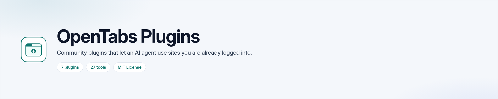
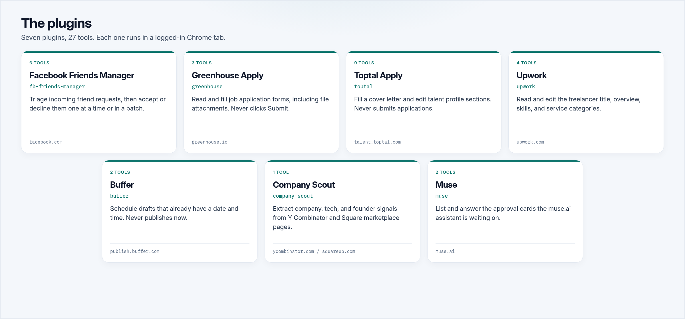
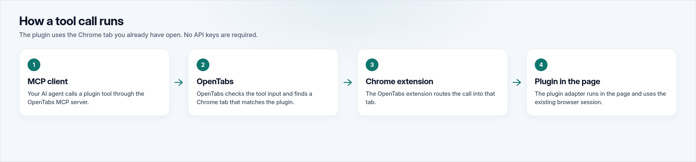

<p align="center">
  
</p>

# OpenTabs Plugins

Community OpenTabs plugins that let an AI agent use sites you are already logged into in Chrome.

Each plugin is a set of MCP tools that run inside an open tab and use the browser session already there. You do not provide API keys.

<p align="center">
  
</p>

## Plugins

| Plugin | Package | Tools | Runs on |
| --- | --- | --- | --- |
| Facebook Friends Manager | `fb-friends-manager` | 6 | `*://*.facebook.com/*` |
| Greenhouse Apply | `greenhouse` | 3 | `*://*.greenhouse.io/*` |
| Toptal Apply | `toptal` | 9 | `*://talent.toptal.com/*` |
| Upwork | `upwork` | 4 | `*://*.upwork.com/*` |
| Buffer | `buffer` | 2 | `*://publish.buffer.com/*` |
| Company Scout | `company-scout` | 1 | YC company pages and Square App Marketplace |
| Muse | `muse` | 2 | `*://muse.ai/*`, `*://*.muse.ai/*` |

### 1. Facebook Friends Manager (`fb-friends-manager`)
**Runs on:** `*://*.facebook.com/*`. **Tools:** 6

Lists pending incoming friend requests and suggests `ACCEPT`, `DELETE`, or `REVIEW` from mutual friend counts and request age. You can accept or decline one request, or run a paced batch.

| Tool | Access | What it does |
| --- | --- | --- |
| `list_friend_requests` | Read | Pending incoming requests with mutual friend counts and timestamps |
| `suggest_triage` | Read | Heuristic recommendations (`ACCEPT`, `DELETE`, `REVIEW`) |
| `confirm_friend_request` | Write | Accepts one request by user ID or username |
| `delete_friend_request` | Write | Declines or deletes one request by user ID or username |
| `batch_triage_requests` | Write | Batch accept and delete, with a delay between actions (default 600 ms) |
| `get_friends_overview` | Read | Mutual friend tiers (0, 1-10, 11-50, 50+) and request age buckets |

---

### 2. Greenhouse Apply (`greenhouse`)
**Runs on:** `*://*.greenhouse.io/*`. **Tools:** 3

Reads and fills Greenhouse job application forms, including resume and cover letter uploads. It never clicks Submit. Public job pages need no login. Only the hosted board (`job-boards.greenhouse.io`) is tested.

| Tool | Access | What it does |
| --- | --- | --- |
| `get_application_form` | Read | Fields, types, required flags, options, current values, and required fields still empty |
| `fill_application` | Write | Fills text, dropdowns, and checkboxes by field id or label (case-insensitive). Never submits |
| `attach_file` | Write | Attaches a resume or cover letter from base64 (PDF, DOC, DOCX, TXT, or RTF, up to 10 MB) |

Dropdowns use `react-select`. The plugin finds the component on the React fiber and calls `selectOption()`.

---

### 3. Toptal Apply (`toptal`)
**Runs on:** `*://talent.toptal.com/*`. **Tools:** 9

Fills the Talent Portal apply flow (cover letter and terms) and edits profile sections, including skills. It never clicks Submit Application.

| Tool | Access | What it does |
| --- | --- | --- |
| `get_apply_state` | Read | Apply wizard step, rate, cover letter length, and terms checkbox |
| `fill_cover_letter` | Write | Types a 380-2000 character cover letter and ticks the terms box. Never submits |
| `get_profile_form` | Read | Editable fields, hints, and the Save button label on a profile section |
| `fill_profile_fields` | Write | Sets text fields and checkboxes by key. Does not save |
| `save_profile` | Write | Clicks Save and reports validation errors |
| `pick_option` | Write | Selects one option in the `industryIds` or `skills` type-ahead picker |
| `set_year` | Write | Sets the `startDate` or `endDate` year on a work-experience form |
| `add_skill` | Write | Adds one skill with proficiency (`COMPETENT`, `STRONG`, or `EXPERT`) and years, then saves |
| `remove_skill` | Write | Removes one skill by exact name, then saves |

---

### 4. Upwork (`upwork`)
**Runs on:** `*://*.upwork.com/*`. **Tools:** 4

Reads and edits the freelancer profile in the open tab. It can change title, overview, skills, and service categories. It cannot change rate, visibility, Connects, or the Open for work badge.

| Tool | Access | What it does |
| --- | --- | --- |
| `get_profile` | Read | Title, hourly rate, overview, skills, and employment lines |
| `set_profile_text` | Write | Updates the title (max 70 characters) or overview (max 5000 characters; http(s) and www links are rejected) |
| `set_skills` | Write | Makes the skill chips exactly the given list (max 20) |
| `set_categories` | Write | Makes the selected sub-categories exactly the given list (max 10) |

---

### 5. Buffer (`buffer`)
**Runs on:** `*://publish.buffer.com/*`. **Tools:** 2

Schedules Buffer drafts that already have a date and time. Creating and editing posts is left to the Buffer API. This plugin only does the schedule step in the web app. It never presses "Publish now", "Share next", or "Add to Queue".

| Tool | Access | What it does |
| --- | --- | --- |
| `list_drafts` | Read | Drafts with preview text, channel, and whether each one already has a time |
| `schedule_drafts` | Write | Schedules timed drafts whose preview starts with the given text, max 10 per call. A longer string matches only a truncated preview. Stops at the first failure |

Open the Drafts tab first. That tab needs a trusted click on `#drafts-tab`.

---

### 6. Company Scout (`company-scout`)
**Runs on:** `*://*.ycombinator.com/companies/*`, `*://*.squareup.com/us/en/app-marketplace/*`, `*://*.squareup.com/app-marketplace/*`. **Tools:** 1

Reads the open Y Combinator company page or Square App Marketplace listing. It extracts name, tagline, description, keyword matches for platforms and tech, and founder names from common team selectors. It does not make background API calls. The tagline is the subtitle under the heading, or the first sentence of the meta description, and it is not a copy of the company name. `Go`, `Square`, `Toast`, `Clover`, `Epic`, and `AWS` match only with that capitalization. `Node.js` matches the dotted name.

| Tool | Access | What it does |
| --- | --- | --- |
| `extract_company_dossier` | Read | Company name, tagline, description, detected platforms, tech keywords, and founders |

---

### 7. Muse (`muse`)
**Runs on:** `*://muse.ai/*`, `*://*.muse.ai/*`. **Tools:** 2

Lists and answers the approval cards the muse.ai assistant waits on. Selectors match the Auto Approve for Muse extension.

| Tool | Access | What it does |
| --- | --- | --- |
| `list_approvals` | Read | Visible approval cards: text, surface (chat or panel), and buttons |
| `respond_approval` | Write | Allow once, always allow, or deny one card. Checks `expect_text` first. `always` falls back to allow once when the card has no Always option |

---

## How it works

<p align="center">
  
</p>

1. An MCP client calls a plugin tool through the OpenTabs server.
2. OpenTabs checks the tool input and finds a Chrome tab whose URL matches the plugin.
3. The OpenTabs Chrome extension routes the call into that tab.
4. The plugin adapter runs in the page and uses the existing browser session. Plugins turn on Zod `jitless` mode so they stay compatible with pages that enforce Trusted Types.

## Install

### Prerequisites

- Node.js 22 (the version used in CI)
- The [OpenTabs CLI](https://opentabs.dev/docs/install) and its Chrome extension, with `opentabs start` already running

### Clone and build

```bash
git clone https://github.com/nadimtuhin/opentabs-plugins.git
cd opentabs-plugins
npm install
npm run build
```

The first `npm run build` registers each plugin in `~/.opentabs/config.json`. You can also list the plugin directories yourself:

```json
{
  "localPlugins": [
    "/path/to/opentabs-plugins/plugins/fb-friends-manager",
    "/path/to/opentabs-plugins/plugins/greenhouse",
    "/path/to/opentabs-plugins/plugins/toptal",
    "/path/to/opentabs-plugins/plugins/upwork",
    "/path/to/opentabs-plugins/plugins/buffer",
    "/path/to/opentabs-plugins/plugins/company-scout",
    "/path/to/opentabs-plugins/plugins/muse"
  ]
}
```

### Call a tool

Open a matching tab in Chrome, then run a tool. Each plugin README has examples that match the tool input schemas. On a Greenhouse application page:

```bash
opentabs tool call greenhouse__get_application_form '{}'
```

## Add a plugin

See [CONTRIBUTING.md](./CONTRIBUTING.md) for the full workflow. In short:

1. Create `plugins/<name>` with a `package.json` that includes the `opentabs` metadata field and URL patterns.
2. Keep tools isolated, each with an explicit Zod schema.
3. Never auto-submit critical forms (checkout, final job submission, payments). Leave the final submit action to the user.
4. Import the `jitless` bootstrap so Zod does not violate Trusted Types CSP.
5. Document every tool in the plugin README under `## Tools (N)`, include at least one `opentabs tool call` example, and add a matching section to this README.

Then run `npm install`, `npm run build`, `npm test`, `npm run type-check`, and `npm run lint`.

## Development

```bash
npm run build
npm run type-check
npm run lint
npm test
```

## License

MIT. See [LICENSE](./LICENSE).
