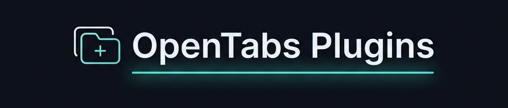
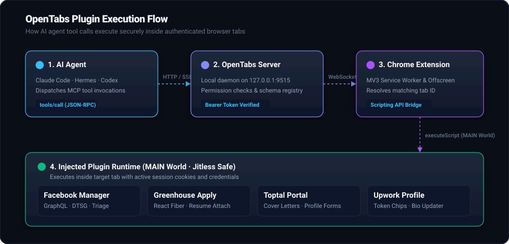

<p align="center">
  
</p>

# OpenTabs Plugins

Collection of browser automation plugins for [OpenTabs](https://github.com/opentabs-dev/opentabs).

Each plugin runs inside your authenticated Chrome or Chromium browser tab via the OpenTabs extension. All actions execute directly in your active browser session without external API keys, service tokens, or OAuth applications.

## Plugins Overview

| Plugin | Domain | Description | Tools |
|---|---|---|:---:|
| [`fb-friends-manager`](./plugins/fb-friends-manager) | `*.facebook.com` | Facebook friend requests triage (accept, delete, mutual friends analysis) | **6** |
| [`greenhouse`](./plugins/greenhouse) | `*.greenhouse.io` | Reads and fills job application forms. Never submits | **3** |
| [`toptal`](./plugins/toptal) | `talent.toptal.com` | Fill talent application cover letters and edit profile sections | **7** |
| [`upwork`](./plugins/upwork) | `*.upwork.com` | Edit freelancer profiles (bio, skills chips, work categories) | **4** |

---

## Architecture & How It Works

<p align="center">
  
</p>

1. **MCP Client (AI Agent):** Claude Code, Hermes, Codex, or Cursor sends standard `tools/call` requests over JSON-RPC.
2. **OpenTabs MCP Server:** Validates tool permissions, parses arguments, and routes the invocation to the extension over a local WebSocket (`ws://127.0.0.1:9515/ws`).
3. **Chrome Extension (MV3):** Finds the matching target tab by URL pattern and communicates with the injected adapter.
4. **Plugin Adapter IIFE:** Executes inside the tab's MAIN world context. Interacts with the live DOM, GraphQL endpoints, and React Fiber stores using active session cookies.

---

## Quick Start

### 1. Prerequisites
- Node.js >= 20
- OpenTabs CLI (`npm install -g @opentabs-dev/cli`)
- OpenTabs Chrome Extension installed and connected

### 2. Clone & Build
```bash
git clone https://github.com/nadimtuhin/opentabs-plugins.git
cd opentabs-plugins
npm install
npm run build
```

### 3. Register Plugins in OpenTabs
Add the built plugins to your `~/.opentabs/config.json`:

```json
{
  "localPlugins": [
    "/path/to/opentabs-plugins/plugins/fb-friends-manager",
    "/path/to/opentabs-plugins/plugins/greenhouse",
    "/path/to/opentabs-plugins/plugins/toptal",
    "/path/to/opentabs-plugins/plugins/upwork"
  ]
}
```

Reload the OpenTabs server:
```bash
opentabs restart
```

---

## Safety Guardrails
- **No Automatic Submissions:** Form plugins (Greenhouse, Toptal) fill fields but never click Submit. You review the page and submit manually.
- **Trusted Types Compliant:** All plugins run in `jitless` mode to prevent CSP `require-trusted-types-for 'script'` failures on high-security web apps (e.g., YouTube, Outlook).
- **Session-Scoped:** No cookies, session identifiers, or credentials leave your local browser runtime.

---

## Development

```bash
# Build all plugins
npm run build

# Run TypeScript checks across all workspaces
npm run type-check

# Run linter
npm run lint
```

---

## License

MIT
